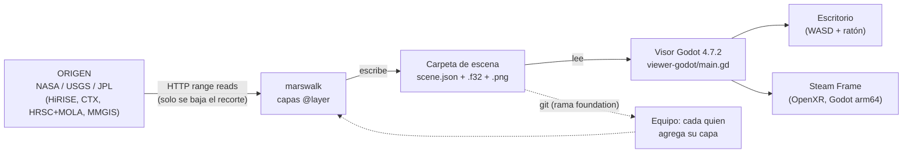

# Flujo de trabajo: de datos orbitales de Marte a caminar en la Steam Frame

Guía para la reunión de equipo. Primero el mapa completo, luego cada etapa, luego cómo entra cada quien con su capa.
Al final hay un guion para explicarlo en la pizarra.

## 1. Mapa conceptual



Idea central: **todo se separa por un contrato**, `scene.json` (formato en `docs/SCENE_FORMAT.md`).
Quien genera datos solo escribe archivos y un manifiesto; el visor solo lee el manifiesto. Ninguno conoce al otro.

```
  datos NASA  ->  [ marswalk: capas ]  ->  carpeta de escena  ->  [ visor Godot ]  ->  pantalla / Frame
                   (Python, numpy)         (scene.json = contrato)    (GDScript)
```

## 2. De dónde vienen los datos

| Dato | Qué es | Resolución | Fuente |
|---|---|---|---|
| HiRISE DTM | Elevación (modelo digital de terreno) | 1 m | USGS/JPL, mosaico Mars 2020 TRN; 1,104 sitios, catálogo en `docs/sites.html` |
| HiRISE ortho | Foto orbital en gris | 25 cm | misma familia, bucket S3 de ASC PDS |
| CTX ortho | Foto orbital más amplia | 6 m (quads solo entre 30°S y 30°N) | mosaicos CTX (Robbins para el anillo lejano, 100 m) |
| HRSC+MOLA | Elevación global | 200 m | blend global, para el horizonte de 80 km |
| Ruta del rover | Trayecto de Perseverance (`M20_traverse.json`) | polilíneas | NASA/JPL MMGIS |

Todo está registrado en `marswalk/sources.py` (`SOURCES`), con nombre, crédito y URL. El crédito viaja dentro de `scene.json`.

## 3. Cómo se descargan

- **No se descarga nada a mano.** Los mapas son COG/GeoTIFF enormes (el ortho pesa ~1.3 GB) y se leen por **HTTP range requests**: se pide solo
  el pedazo de bytes que cubre el parche (`RemoteBigTiff`, sin GDAL).
- Un sitio se escoge con `docs/sites.html` (ID) o con coordenadas (`marswalk find -- lon lat` dice qué DTM cubren ese punto).
- Un build tarda 2 a 5 minutos; lo pesado va en **archieval**, no en Archie.

## 4. Cómo se procesan

`marswalk build --site <ID> --lon L --lat B --out viewer-godot/mi_escena`

1. Convierte lon/lat a metros locales: origen en el waypoint, **x este, z sur, y arriba**, fila 0 = norte (`marswalk/geo.py`).
2. Corre cada **capa** en orden (`ORDER`), respetando `requires`.
3. Cada capa lee fuentes, escribe archivos en la carpeta de escena y devuelve entradas de manifiesto.
4. Escribe `scene.json` y **valida** (`marswalk validate`); termina con `OK`.

Detalles que cuestan caro si se olvidan:
- Los DTM HiRISE tienen huecos de nodata gigantes. Los anillos rellenan con el DEM global de 200 m **ajustando el desfase** (difiere decenas a cientos de metros), con mezcla suave y gaussiano con padding para no dejar acantilados.
- Un build parcial (`--layers`) reescribe `scene.json` solo con esas capas: antes de commitear, haga un build completo.

## 5. Las capas

| Capa | Qué hace | Archivo | Requiere |
|---|---|---|---|
| `terrain` | Parche caminable, 1 m, 91x91 muestras (90 m) | `heightmap.f32` | - |
| `ortho` | Foto orbital 25 cm sobre el parche | `ortho.png` | terrain |
| `route` | Tramos del recorrido del rover dentro del parche | `route_local.json` | - |
| `ring_3km` | Relieve cercano 3 km a 6 m + textura (CTX + HiRISE) | `ring_3km.f32/.png` | terrain |
| `ring_6km` | Campo medio 6 km a 12 m | `ring_6km.f32/.png` | terrain |
| `ring_80km` | Horizonte 80 km a 160 m (HRSC+MOLA) | `ring_80km.f32/.png` | terrain |
| `slope` | Pendiente en grados; el visor marca peligro > 15° (tecla H) | `slope.f32` | terrain |

Los **anillos** son mallas concéntricas con `inner_skip_m` (hueco central donde ya hay datos más finos) y `view{subsample, lower_m}`; el visor las baja un poco para evitar z-fighting.
La rugosidad fina (rocas, guijarros, polvo) es procedural en el visor, no viene de datos.

## 6. Cómo se crea el ambiente en Godot

- `viewer-godot/main.gd` lee `scene.json` de la carpeta indicada por `--patch=<carpeta>` y construye: malla del parche (shader con la foto ortho), anillos
  (shader con textura + ganancia para empatar brillo con el parche), ruta, mapa de peligro, rocas procedurales y rover.
- Se prueba en escritorio: `cd viewer-godot && godot --path . -- --patch=scene_olympus`.
  Controles: WASD, ratón, Shift, clic derecho, H (peligro), Esc. Flags: `--cam`, `--norover`, `--shot`.
- El mismo proyecto Godot soporta **OpenXR**: en la Frame se lanza en modo VR.

## 7. Cómo se envía a la Steam Frame

```
 git repo --(git archive viewer-godot)--> tools/frame/make_bundle.sh --> mars-frame-bundle.tgz
   (Godot arm64 4.7.2 se baja de godot-builds; no se commitea, pesa 138 MB)
 tgz --> copiar a la Frame --> install.sh --> mars-flat.sh (pantalla plana) / mars-xr.sh (VR OpenXR)
```

1. `tools/frame/make_bundle.sh` arma `mars-frame-bundle.tgz` = `install.sh` + Godot arm64 + el proyecto `viewer-godot` (con sus escenas).
2. Se copia a la Frame (la Frame ya tiene Tailscale, SSH directo).
3. `install.sh` lo despliega y crea los lanzadores `mars-flat.sh` y `mars-xr.sh`.
4. Para otra escena: generarla, commitearla, volver a armar el bundle.

Pendiente: el bundle aún no se ha probado de punta a punta con las escenas nuevas.

## 8. Cómo entra cada quien con su capa

```bash
git clone https://github.com/Schmc444/mars-walk-mission.git && cd mars-walk-mission
git checkout foundation
python3 -m venv .venv && source .venv/bin/activate && pip install -e .
```

(El repo es privado: hay que ser colaborador.) Luego, en `marswalk/layers.py`:

```python
@layer("mi_capa", requires=("terrain",))
def mi_capa(ctx):                      # ctx.site, ctx.wp, ctx.out, ctx.size_m, ctx.scene
    datos = ...                        # leer una fuente (agréguela a marswalk/sources.py)
    datos.astype("f4").tofile(ctx.path("mi_capa.f32"))
    return [dict(id="mi_capa", title="Mi capa", kind="scalar", file="mi_capa.f32", dtype="f32",
                 samples=datos.shape[0], step_m=1.0, half_m=ctx.size_m / 2, unit="...",
                 source=src("mi_fuente"))]
```

Ciclo de trabajo:
1. Escribir la capa y su fuente (con crédito).
2. `marswalk build ... --layers terrain,mi_capa --out /tmp/prueba` y `marswalk validate /tmp/prueba`.
3. Si el visor debe dibujarla, agregar el `kind` correspondiente en `viewer-godot/main.gd`.
4. `pytest tests -q`, commit a una rama propia, pull request hacia `foundation`.
5. Escenas generadas (carpetas `scene_*`): se construyen en archieval, se commitean ahí y se sincronizan **solo por git**.

Reglas del contrato: ejes (x este, z sur, y arriba), alturas relativas al waypoint, fila 0 = norte, unidades en el manifiesto, créditos siempre.

## 9. Guion para la pizarra (unos 10 minutos)

Dibujar de izquierda a derecha, una caja por paso:

1. **Caja "NASA"** (izquierda): escribir HiRISE 1 m / 25 cm, CTX 6 m, HRSC+MOLA 200 m, ruta del rover. Decir: "datos reales, públicos".
2. **Flecha "range reads"**: "no bajamos 1.3 GB, pedimos solo el recorte por HTTP".
3. **Caja "marswalk"**: dibujar una pila de 7 capas (terrain, ortho, route, ring_3km, ring_6km, ring_80km, slope). Marcar con otro color el lugar de "su capa".
4. **Caja "escena"** (centro, grande, remarcada): `scene.json` + archivos. Decir: "este es el contrato; lo único que comparten Python y Godot".
5. **Caja "Godot"**: parche 90 m al centro y tres anillos concéntricos (3, 6, 80 km). Decir por qué: la curvatura de Marte deja el horizonte en ~3.4 km; los anillos dan montañas lejanas.
6. **Dos flechas de salida**: escritorio (probar) y Steam Frame (bundle arm64 con OpenXR).
7. **Franja inferior "git"**: una sola flecha circular: archieval construye, commit, push, todos hacen pull. "Nada de scp."
8. **Cierre: ¿quién hace qué?** Una fila por persona: su capa, su fuente, su archivo de salida, cómo se ve en Godot.

Preguntas que probablemente salgan:
- *¿Por qué anillos y no un solo mapa?* Resolución dónde importa: 1 m cerca, 160 m lejos; el costo se mantiene bajo para VR.
- *¿Qué es real y qué inventado?* Relieve y fotos son orbitales; rocas y polvo son procedurales.
- *¿Por qué hay huecos?* Los DTM HiRISE tienen nodata; se rellenan con el DEM global ajustado.
- *¿Y fuera de ±30° de latitud?* No hay CTX quads: el anillo queda de un solo color (pendiente: THEMIS IR).
